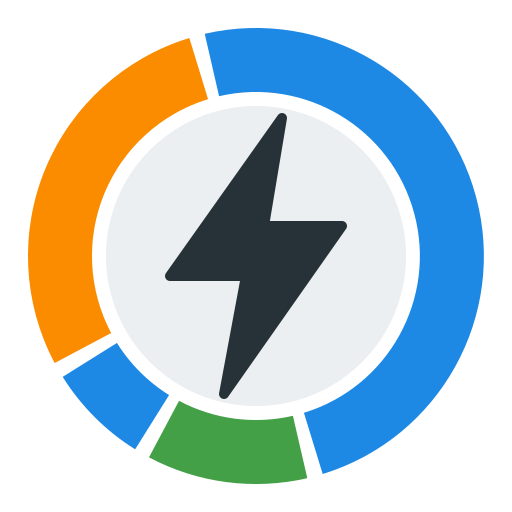

# Time-of-use tariff for Home Assistant (with optional GloBird ZEROHERO extras)

[](https://github.com/andrewgould/ha-globird-zerohero/actions/workflows/ci.yml)
[](https://github.com/andrewgould/ha-globird-zerohero/releases)
[](https://hacs.xyz)

Live import/export price sensors for a **fixed time-of-use electricity plan**, built to plug directly into Home Assistant's Energy dashboard cost tracking. Works with any retailer whose rates are a fixed daily schedule; it was written for [GloBird Energy](https://www.globirdenergy.com.au/)'s **ZEROHERO** plan, whose extras it can additionally track if you're on it.

## Why this exists

A time-of-use plan's price is a **fixed daily schedule** (e.g. free import 11am-2pm, peak 3-9pm), not a live wholesale-linked price like Amber Electric. That means the current price can be computed purely from the time of day and your configured rate schedule -- no polling your retailer, no portal login, no scraping. This integration does exactly that.

If you're on GloBird ZEROHERO, it can also track that plan's three bonus mechanics (ZeroHero credit, ZeroWastedSolar boost, ZeroLimits critical peak events) as informational sensors. **Each is opt-in and off by default** -- on any other retailer you'll never see them, and the setup flow is just your rate schedule.

Two existing projects were checked before building this and neither covers this gap: [globird-ha](https://github.com/bolagnaise/globird-ha) exposes account/usage/cost history via portal login but explicitly doesn't expose rate/pricing sensors; [ha-pricehawk](https://github.com/Artic0din/ha-pricehawk) lets you configure GloBird rates but only produces accumulated cost totals, not a live per-kWh price entity.

## What you get

- **Current import price** and **current export price** sensors (`device_class: monetary`, `AUD/kWh`, updates exactly at each price-window boundary) -- point HA's Energy dashboard **Configure grid connection** at these:
  - Grid consumption cost -> "Use an entity with the current price" -> *Current import price*
  - Return to grid compensation -> "Use an entity with the current price" -> *Current export price*
- Price tier label (Free / Off-peak / Peak / ZeroWastedSolar boost / Critical peak)
- Next price change (timestamp) -- the next time the **import** price actually changes. Export-window edges and window splits that keep the same rate (an off-peak block divided at midnight, say) aren't price changes, so they're not reported here. `unknown` if your import schedule is a single flat rate.
- Daily supply charge (informational)
- Only if you switch the matching GloBird program on during setup:
  - **ZeroHero** credit status for today (pending / earned / missed)
  - **ZeroWastedSolar** kWh remaining today
  - **ZeroLimits**: a switch to manually flag a critical peak event (or point the integration at an `input_boolean`/`binary_sensor` you already use for this)

## Install

Through [HACS](https://hacs.xyz), as a custom repository:

[](https://my.home-assistant.io/redirect/hacs_repository/?owner=andrewgould&repository=ha-globird-zerohero&category=integration)

Or in HACS, **⋮ → Custom repositories**, add `https://github.com/andrewgould/ha-globird-zerohero` as an **Integration**, then download
**Time-of-use tariff (GloBird ZEROHERO)** and restart Home Assistant.

Without HACS, unzip `globird_zerohero.zip` from the [latest release](https://github.com/andrewgould/ha-globird-zerohero/releases/latest) into
`custom_components/globird_zerohero` and restart.

Then **Settings → Devices & services → Add integration** and search for *Time-of-use tariff*:

[](https://my.home-assistant.io/redirect/config_flow_start/?domain=globird_zerohero)

Needs Home Assistant 2024.6 or later. The icon shows from 2026.3, which reads it from the
integration's own `brand/` folder. HACS installs from [tagged releases](https://github.com/andrewgould/ha-globird-zerohero/releases), so new
versions appear as updates; [CHANGELOG.md](CHANGELOG.md) says what's in each one.

## Setup

You'll need your current rates from your bill or your retailer's published price fact sheet for your distribution area -- the config flow pre-fills GloBird's published Jemena ZEROHERO numbers as an example starting point, but **you enter and own the numbers**; nothing is scraped or auto-updated, so re-check them when your rates change.

1. Plan label, daily supply charge, and which (if any) GloBird programs to track. All three are off by default.
2. Import (grid consumption) price schedule -- up to 6 time windows, must cover the full 24 hours with no gaps or overlaps.
3. Export (feed-in) price schedule -- same shape.
4. *(only if ZeroHero is on)* Credit threshold/window/amount and your grid-import sensor.
5. *(only if ZeroWastedSolar is on)* Rate/cap/window and your solar-export sensor.
6. *(only if ZeroLimits is on)* Critical-peak rates and toggle source.

Steps 4-6 are skipped entirely when their program is off, so a plain time-of-use setup is three steps.

Everything is editable later without removing the integration: **Settings -> Devices & services -> the integration -> Configure**.

### Upgrading from a pre-1.0 install

Config entries are migrated automatically the first time 1.0 loads. The old single "track bonus features" toggle becomes one flag per program, inferred from what you'd actually configured. Nothing needs re-entering and no entity IDs change -- including the integration's domain, which stays `globird_zerohero` whatever the display name says.

### Flagging a ZeroLimits critical peak event

GloBird announces these ad-hoc via its app with no public API to detect them automatically. When you get the notification, turn on the **ZeroLimits critical peak active** switch (or your linked helper entity) for the duration of the event; turn it off when it ends. While active, the current export price switches to the critical-peak rate and the current import price includes the surcharge.

## Documented assumptions

- **Critical peak overrides ZeroWastedSolar, rather than stacking.** GloBird doesn't publish how the two interact when both would apply; this integration uses the higher-precedence critical-peak rate outright.
- **ZeroHero threshold detection works best against a power (W/kW) sensor.** If you only have a cumulative energy sensor linked, eligibility is approximated from a rolling delta sampled during the evening window, which can be less precise for very brief spikes.
- **The rate schedule uses a bounded number of time windows** (6 max per direction), which comfortably covers a typical 4-5 window plan. A plan with more windows than that would need this extending.
- **Public holiday / day-type variation is not modelled.** Every day uses the same schedule.

## Development

```bash
python -m venv .venv && source .venv/bin/activate
pip install -r requirements_test.txt ruff
ruff check . && pytest -q
```

`schedule.py` and `pricing.py` are the core pricing algorithm and are framework-free (no Home Assistant imports), so most of the test suite runs as plain pytest with no `hass` fixture. `coordinator.py`, `config_flow.py`, `sensor.py`, and `switch.py` are the Home Assistant integration glue.

## Releasing

Bump `version` in `custom_components/globird_zerohero/manifest.json`, add a matching `## X.Y.Z`
section to `CHANGELOG.md` saying what changed and why it matters, then tag and push:

```bash
git tag vX.Y.Z && git push origin vX.Y.Z
```

The **Release** workflow checks the tag against the manifest, runs the tests, builds
`globird_zerohero.zip` and publishes the release with that changelog section as its notes. It
refuses to publish a version with no changelog section. HACS installs from the zip.

The icon is drawn by `assets/make_icons.py`, which writes the PNGs into the integration's `brand/`
folder.

## License

MIT
